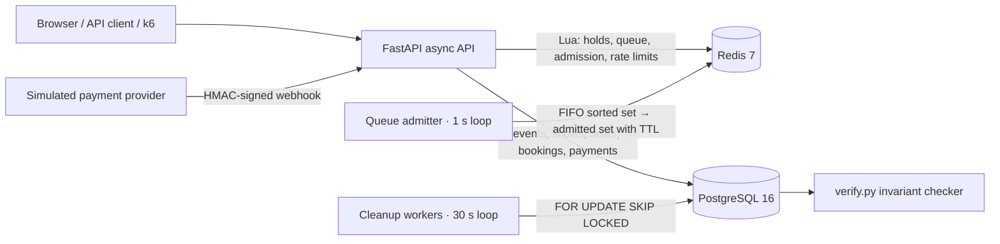
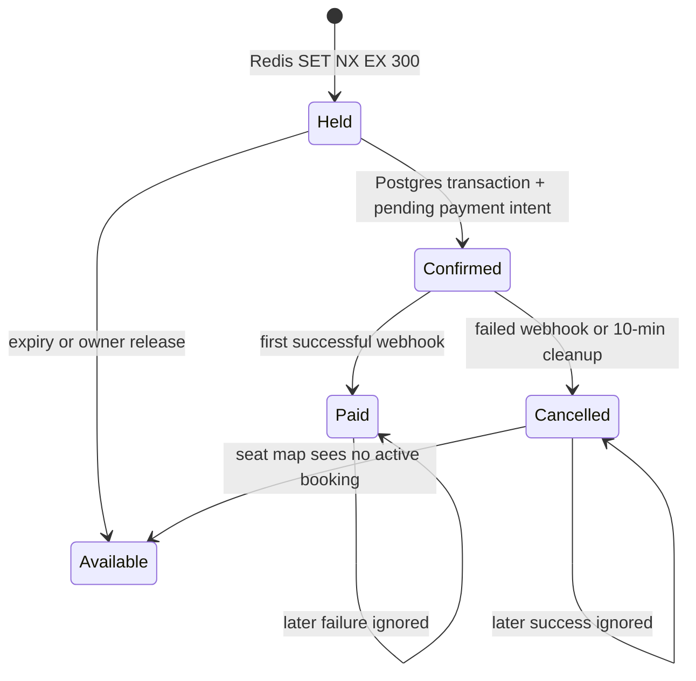

<div align="center">

# 🎟️ Seatlock

**10,000 users. 500 seats. Zero double bookings.**

A flash-sale reservation backend that turns a stampede into exactly one durable winner per seat.

[](https://github.com/varunsahu258/seatlock/actions/workflows/ci.yml)


</div>

---

## What this proves

Ticket drops are a classic concurrency trap: thousands of people click the same seat in the same second. Seatlock is built around one promise: **a seat is never sold twice**, even when Redis expires keys mid-request, workers crash, or payment webhooks arrive late and duplicated.

| Verified outcome (k6, 10,000 virtual users) | Result |
| --- | --- |
| Seats sold | **500 / 500** |
| Double bookings (Postgres invariant checker) | **0** |
| Bookings missing payment or live-hold evidence | **0** |
| Contended seat attempts handled | 35,144 |

Raw data: [`loadtest/results.json`](loadtest/results.json) · history of every run: [`docs/benchmarks.md`](docs/benchmarks.md) · sampled seat-by-seat replay: [`loadtest/events.json`](loadtest/events.json)

### Read this before you quote the numbers

The load test ran the **API, PostgreSQL, Redis and k6 all on one 8 GB laptop** (k6 capped at `GOMAXPROCS=2`, Docker given 4 CPUs). Under that pressure p50 latency was 2.64 s, p95 about 30 s, throughput about 499 req/s, and **65% of HTTP requests failed** (timeouts and connection pressure). The *safety* result held; this is **not** a production capacity claim. A proper capacity run needs k6 on a separate machine and pool sizes tuned to the host.

The benchmark log is also honest about earlier runs. The first verified run exposed 25 bookings without payment evidence, which led to creating payment intents atomically inside the booking-confirmation transaction. Finding and fixing that is exactly what the invariant checker is for.

## How it works



**Two systems, two jobs:**

- **Redis = speed.** Short-lived (5 min) seat holds, the FIFO waiting room and rate limits. All use atomic Lua scripts.
- **PostgreSQL = truth.** Durable bookings, payment records, and a **partial unique index** on `(show_id, seat_id)` for active bookings. Even if Redis loses data, the database refuses a second active booking.

### Booking lifecycle



### Concurrency decisions that matter

| Problem | Solution |
| --- | --- |
| Old owner's delayed release deletes the *new* owner's hold | **Lua compare-and-delete**; `GET` then `DEL` has a race |
| Redis and Postgres can't share a transaction | Redis checks ownership first, Postgres **unique index** is the final authority; conflict returns `409` |
| One user hammering the API | **Token-bucket rate limiting inside Lua**, same atomic step as the action |
| Thundering herd | **FIFO waiting room**: sorted-set order, owner-bound admission tokens, configurable admit rate per show |
| Duplicate / out-of-order payment webhooks | Unique `provider_event_id` + `ON CONFLICT DO NOTHING` + booking row lock; **first terminal outcome wins** |
| Forged webhooks | **HMAC-SHA256 over the raw body**, constant-time comparison |
| Unpaid bookings hoarding seats | Cleanup workers cancel after 10 min using **`FOR UPDATE SKIP LOCKED`** so workers scale horizontally without blocking |

More rationale: [DECISIONS.md](DECISIONS.md) · schema: [docs/schema.md](docs/schema.md)

## Quick start

Requirements: Python 3.12, [uv](https://docs.astral.sh/uv/), Docker Compose v2 (k6 and `jq` only for the load test).

```bash
git clone https://github.com/YOUR-USERNAME/seatlock.git && cd seatlock
uv sync --all-groups
docker compose up -d --wait
uv run alembic upgrade head
uv run uvicorn app.main:app --reload
```

API at http://localhost:8000 · Swagger at `/docs` · OpenAPI at `/openapi.json`.

### Run a flash sale

```bash
make admitter     # waiting-room worker (separate terminal)
make worker       # unpaid-booking cleanup worker
make loadtest     # 10,000 VUs by default; try VUS=1000 ADMIT_RATE=250 make loadtest
```

The harness creates a 500-seat queue-enabled show, runs the k6 `flash_sale` scenario (join queue → wait for admission → contend for seats → confirm → pay → signed webhook), then `verify.py` checks the database directly:

1. No seat has more than one active booking.
2. Active bookings never exceed capacity.
3. Every active booking has a payment record or a live hold.

## Try the API

```bash
# create an event and a 500-seat show
curl -sX POST localhost:8000/admin/events -H 'Content-Type: application/json' -d '{"name":"Summer festival"}'
curl -sX POST localhost:8000/admin/shows -H 'Content-Type: application/json' \
  -d '{"event_id":1,"starts_at":"2030-06-01T19:30:00Z","seat_count":500,"seat_price_minor":2500}'

# hold, confirm, pay
curl -sX POST localhost:8000/shows/1/seats/1/hold -H 'X-User-Id: user-42'
curl -sX POST localhost:8000/bookings/confirm -H 'X-User-Id: user-42' \
  -H 'Content-Type: application/json' -d '{"show_id":1,"seat_ids":[1]}'
```

| Endpoint | Purpose |
| --- | --- |
| `GET /shows/{id}/seats` | Live seat map (`available` / `held` / `booked`) |
| `POST /shows/{id}/queue/join` · `GET .../queue/status` | Waiting room |
| `POST /shows/{id}/seats/{seat}/hold` | 5-minute hold (max 6 per user per show) |
| `POST /bookings/confirm` | Confirm 1-6 holds atomically |
| `POST /bookings/{id}/pay` | Create or return payment intent |
| `POST /webhooks/payment` | HMAC-signed provider callback, idempotent |
| `GET /health` | Postgres and Redis connectivity |

Full reference: [site/api.html](site/api.html) (Redoc) · [site/openapi.json](site/openapi.json)

## Visual showcase (no backend needed)

`make site` builds a static site: an **animated 500-seat replay** of the flash sale, a results dashboard, a system guide and the API reference. Preview with `python3 -m http.server 8001 --directory site`.

> 📸 **Add a GIF of the seat replay here**; it is the most shareable part of this project.

## Testing

```bash
make check   # Ruff + mypy + pytest
```

Covers: racing seat holds, six-seat quota, hold expiry and release ownership, queue ordering and rate limiting, **concurrent webhook replay**, invalid signatures, **late and out-of-order payment outcomes**, and **concurrent cleanup workers** (needs PostgreSQL). CI runs migrations and tests against real PostgreSQL 16 and Redis 7.

## Project layout

```text
app/
  api/        routes and dependencies
  core/       settings, async DB, Redis Lua scripts
  models/     SQLAlchemy entities and constraints
  schemas/    Pydantic contracts
  workers/    queue admitter, unpaid-booking cleanup
alembic/      migrations (initial → payment flow → waiting room)
loadtest/     k6 scenario, runner, DB verifier, results
site/         static replay, dashboard, Redoc
tests/        API, Redis, payments, concurrency
```

## Honest limitations

- `X-User-Id` is a development identity, **not authentication**. Admin routes accept an optional bearer token.
- Payments are simulated; a real provider needs replay windows, amount reconciliation and alerting.
- Redis state is ephemeral; production needs HA/persistence decisions and outage behavior.
- The replay is a sampled visualization, not a full audit trace.
- Business logic still lives in `api/routes.py`; extracting a service layer is the next refactor.

## Roadmap

- [ ] Re-run the benchmark with k6 on a separate host and tuned connection pools
- [ ] Real authentication (JWT) in place of `X-User-Id`
- [ ] Extract a `services/` layer from routes
- [ ] Prometheus metrics, tracing, and Redis outage degradation tests

## License

MIT. See [LICENSE](LICENSE).
