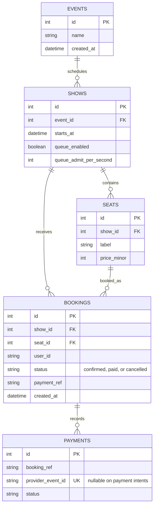

# Database schema

A partial unique index on `(show_id, seat_id)` where status is `confirmed` or `paid` prevents two active/paid bookings for one seat while allowing cancelled booking history. A second partial unique index permits one pending intent (no provider event ID yet) per booking. Webhook events have a unique provider event ID for idempotency. Redis holds are ephemeral keys in the form `hold:{show_id}:{seat_id}` with a TTL controlled by `HOLD_TTL_SECONDS` (default 300). The seat map treats confirmed and paid bookings as booked and gives them precedence over live holds. Queue-enabled shows keep FIFO waiting tokens in a Redis sorted set; a Redis Lua token bucket globally caps admissions per show per second, and admitted tokens are kept in a TTL-backed set and owner hash.
